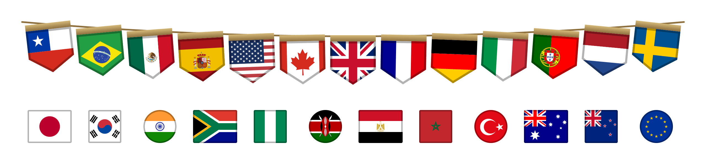

# pennants

[](https://www.npmjs.com/package/pennants)
[](https://d3vaya.github.io/pennants/guide/performance)
[](https://github.com/D3vaya/pennants/actions/workflows/ci.yml)
[](https://github.com/D3vaya/pennants/blob/main/LICENSE)

Every flag, every shape, one API. 271 country flags (249 ISO 3166-1 countries plus regions and
organizations) as pennants, the signature style, and as 4:3 rectangles, squares and circles.
SVG, PNG, CSS classes, tree-shakable ES modules, a React component and a Web
Component. Typed and lazy: you only ship the flags you show.



**[Documentation](https://d3vaya.github.io/pennants/)** ·
**[Gallery](https://d3vaya.github.io/pennants/gallery)** ·
[Which format?](https://d3vaya.github.io/pennants/guide/formats) ·
[Shapes](https://d3vaya.github.io/pennants/guide/shapes) ·
[API](https://d3vaya.github.io/pennants/api/) ·
[Changelog](https://d3vaya.github.io/pennants/guide/changelog) ·
[Español](https://d3vaya.github.io/pennants/es/)

```sh
npm install pennants
```

## Quick start

**CSS classes**: no JavaScript, images load per used class.

```js
import 'pennants/css';
```

```html
<span class="pn pn-cl" role="img" aria-label="Chile"></span>
```

**Image or CDN**: zero bundle cost.

```html

```

**One module per flag**: tree-shaken artwork, framed in any shape.

```js
import { renderFlag } from 'pennants';
import cl from 'pennants/art/1x1/cl';

renderFlag(cl, { shape: 'circle' }); // SVG markup
```

**Lazy, by code**: each flag is its own chunk.

```js
import { loadFlag, getPennantName } from 'pennants';

const svg = await loadFlag('cl'); // or loadFlag('cl', { shape: 'rect' })
getPennantName('de', 'es'); // 'Alemania'
```

**React**: accessible name by default, SSR-safe.

```jsx
import { Pennant } from 'pennants/react';

<Pennant code="cl" size={32} />;
```

**Web Component**: no framework.

```html
<script type="module">
  import 'pennants/element/register';
</script>
<pennant-flag code="cl" size="32"></pennant-flag>
```

**Shapes**: `pennant` (default), `rect` (4:3), `square`, `circle`. Pass `shape` to any API. For
CSS, import `pennants/css/circle` (or `rect`, `square`) and use `pn-circle pn-cl`; stylesheets
combine on one page.

Also: `pennants/svg/<shape>/<code>.svg` and `pennants/png/pennant/{1x,2x}/<code>.png`. PNGs of
the other shapes and SVG sprites are in `pennants-assets-vX.Y.Z.zip` on each
[GitHub release](https://github.com/D3vaya/pennants/releases).

## Weight

<!-- sizes:start (generated by scripts/docs-readme-sizes.ts) -->

Measured with Vite 8.3.6 (production build, difference against an empty app, gzip).
Generated from `npm run bundle:budget`; see the docs for min and brotli.

| You use                                         | Added up front | Lazy files ³ |
| ----------------------------------------------- | -------------- | ------------ |
| `` / CDN, PNG                              | 0              | 0            |
| CSS classes, `assetsInlineLimit` set ¹          | 3.8 kB CSS     | 0            |
| CSS classes, `pennants/css/cdn` ²               | 2.0 kB CSS     | 0            |
| One flag, static import (`pennants/art/1x1/cl`) | 1.2 kB JS      | 0            |
| `getPennantName`                                | 1.0 kB JS      | 0            |
| `fetchPennant` (`pennants/fetch`)               | 2.1 kB JS      | 0            |
| `loadFlag` / `loadPennant`                      | 2.5 kB JS      | 544          |
| React `<Pennant>`                               | 4.7 kB JS      | 545          |
| `<pennant-flag>`                                | 5.2 kB JS      | 545          |

¹ With Vite's defaults every flag is inlined into the CSS (53.0 kB gzip); see the
[FAQ](https://d3vaya.github.io/pennants/guide/faq#bundler-asset-imports). Next.js and Angular do
not inline.
² Same classes, with flag URLs pointing at jsDelivr (version-pinned); bundlers leave them alone.
³ Emitted into your build, downloaded only when that flag is shown.

<!-- sizes:end -->

More numbers, including min and brotli: [Performance & weight](https://d3vaya.github.io/pennants/guide/performance)
and the [comparison with flag-icons and country-flag-icons](https://d3vaya.github.io/pennants/guide/comparison).

## Compared with flag-icons

The artwork is [flag-icons](https://github.com/lipis/flag-icons)' and the codes are the same:
`fi fi-cl` becomes `pn pn-cl`, or `pn-rect pn-cl` with `pennants/css/rect` to keep 4:3
rectangles.

|                                 | flag-icons            | pennants                               |
| ------------------------------- | --------------------- | -------------------------------------- |
| Shapes                          | Rectangle 4:3 and 1:1 | Pennant, rectangle 4:3, square, circle |
| SVG files and CSS classes       | Yes                   | Yes                                    |
| PNG and SVG sprite              | No                    | Yes (sprites as release assets)        |
| JS module per flag, lazy loader | No                    | Yes                                    |
| TypeScript types                | No                    | `PennantCode` union, typed API         |
| Localized names                 | No                    | `getPennantName` (`Intl.DisplayNames`) |
| React and Web Component         | No                    | Yes                                    |
| Themeable bar                   | No                    | CSS custom properties                  |

See [Migrating from flag-icons](https://d3vaya.github.io/pennants/guide/migration).

## Good to know

- ESM only. Node.js 20.19+ (where `require()` of ESM also works). React 18+ for
  `pennants/react`.
- Only pass markup from `renderFlag`, `loadFlag` or `fetchPennant` to `innerHTML`, and artwork from
  `pennants/art/*` to `<PennantSvg>`; never user input.
- The pennant's bar can be themed with `--pennant-bar-light` and `--pennant-bar-dark`.

## Contributing

See [CONTRIBUTING.md](https://github.com/D3vaya/pennants/blob/main/CONTRIBUTING.md) and [SECURITY.md](https://github.com/D3vaya/pennants/blob/main/SECURITY.md).

## License

[MIT](https://github.com/D3vaya/pennants/blob/main/LICENSE) © 2026 d3vaya. Flag artwork from flag-icons, MIT © 2013 Panayiotis Lipiridis; see
[NOTICE](https://github.com/D3vaya/pennants/blob/main/NOTICE).

## En español

Banderas de países como banderines, rectángulos 4:3, cuadrados y círculos, en todos los
formatos: SVG, PNG, CSS, módulos JS, React y Web Component. Documentación completa en español:
**[d3vaya.github.io/pennants/es/](https://d3vaya.github.io/pennants/es/)**.

```js
import 'pennants/css'; // <span class="pn pn-cl"></span>
```
